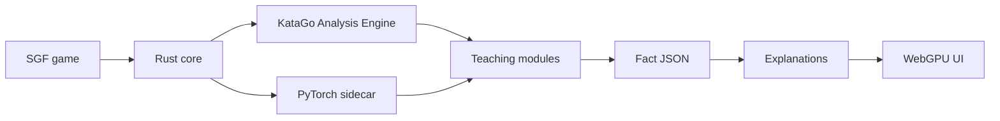

# Yagoo

**Interpret KataGo. Teach real games.**

Yagoo is a practical Go (weiqi / baduk) review and teaching tool. Its differentiator is **interpretability of KataGo network internals** — not treating KataGo as another black-box winrate judge.



## What you get

| Module | Question it answers |
| --- | --- |
| **Groups** | Which stones move together across futures? |
| **Tempo sensitivity** | Is this group “whoever plays first wins”? |
| **Score distribution** | Fine endgame or unresolved fight? |
| **Positional zoning** | Territory, moyo, thickness, weak groups |
| **Gain / loss ledger** | Why was this move big — or a mistake? |
| **Concept heads** *(later)* | Eyes, liberty race, cut points |
| **Explanation generation** | Structured facts → teaching text |

## Non-goals (short)

- Black-box winrate / “R4” style judging alone
- Academic interpretability research as the product
- Designing for rare adversarial KataGo failure modes (e.g. cyclic groups)
- Tsumego solvers

Details: [Goals & non-goals](docs/goals.md).

## Stack direction

| Layer | Choice |
| --- | --- |
| Core / analysis clients | **Rust** (Cargo workspace) |
| Frontend | **Web** with **WebGPU** (not Electron) |
| Model utilities | **Python** via **uv**, managed under **mise** |
| Toolchain | **mise** (Rust, Node, uv) — same convention as [heron](https://github.com/minori-live/heron) |

Pinned teaching net for v1 work: **`kata1-b18c384nbt-s9996604416-d4316597426`** (SWA weights). Larger nets later; concept heads bind to the chosen net.

## Docs

Start at **[docs/](docs/index.md)** — glossary, data sources, one page per module, architecture, MVP plan, open questions.

## Development

```sh
mise install
mise run check
mise run docs          # VitePress docs site
```

Foundation: board/SGF/KataGo client, **streaming snapshot pipeline**, and `yagoo analyze` CLI. Teaching algorithms (groups, tempo, …) come next.

```sh
# Local KataGo assets (not CI) — downloads b18 .bin.gz + sample analysis.cfg;
# install the KataGo binary from upstream releases onto PATH first.
mise run katago:fetch-dev

export YAGOO_KATAGO=.yagoo-data/bin/katago
export YAGOO_MODEL=.yagoo-data/models/kata1-b18c384nbt-s9996604416-d4316597426.bin.gz
export YAGOO_ANALYSIS_CONFIG=.yagoo-data/config/analysis.cfg

cargo run -p yagoo-cli -- analyze game.sgf -o events.ndjson --final-json game.json
```

See [streaming pipeline](docs/pipeline/streaming.md) and [snapshot schema](docs/pipeline/snapshots.md).

## License

[Apache License 2.0](LICENSE)
