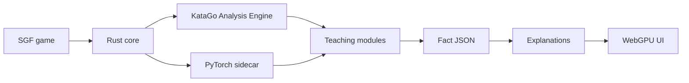

# Yagoo

**Interpret KataGo. Teach real games.**

Yagoo is a practical Go (weiqi / baduk) review and teaching tool. Its differentiator is **interpretability of KataGo network internals** — not treating KataGo as another black-box winrate judge.



## What you get

| Module | Question it answers |
| --- | --- |
| **Groups** | Which stones move together across futures? |
| **Tempo sensitivity** | Is this group “whoever plays first wins”? |
| **Score distribution** | Fine endgame or unresolved fight? |
| **Positional zoning** | Territory, moyo, thickness, weak groups |
| **Gain / loss ledger** | Why was this move big — or a mistake? |
| **Concept heads** *(later)* | Eyes, liberty race, cut points |
| **Explanation generation** | Structured facts → teaching text |

## Non-goals (short)

- Black-box winrate / “R4” style judging alone
- Academic interpretability research as the product
- Designing for rare adversarial KataGo failure modes (e.g. cyclic groups)
- Tsumego solvers

Details: [Goals & non-goals](docs/goals.md).

## Stack direction

| Layer | Choice |
| --- | --- |
| Core / analysis clients | **Rust** (Cargo workspace) |
| Frontend | **Web** with **WebGPU** (not Electron) |
| Model utilities | **Python** via **uv**, managed under **mise** |
| Toolchain | **mise** (Rust, Node, uv) — same convention as [heron](https://github.com/minori-live/heron) |

Pinned teaching net for v1 work: **`kata1-b18c384nbt-s9996604416-d4316597426`** (SWA weights). Larger nets later; concept heads bind to the chosen net.

## Docs

Start at **[docs/](docs/index.md)** — glossary, data sources, one page per module, architecture, MVP plan, open questions.

The published site is **[yet-another-ai.github.io/yagoo](https://yet-another-ai.github.io/yagoo/)**. [`.github/workflows/pages.yml`](.github/workflows/pages.yml) runs `mise run pages:build` and deploys to GitHub Pages on pushes to `main` (and on manual dispatch). Pull requests build the same artifact and do not deploy. This repository's Pages source is already **GitHub Actions**.

VitePress `base` is `/yagoo/`, including for local dev, so asset URLs match production:

```sh
mise run docs
# http://localhost:5173/yagoo/
```

The reviewer is at `/yagoo/app/`. `/yagoo/demo/` is the same reviewer full page, without the docs sidebar or footer. Both load the bundled SGF and NDJSON from `/yagoo/app/` and keep that recorded analysis until a model is loaded. The site does not host KataGo weights. **Engine** → **Load local model** stages a local bundle; **Use browser engine** runs it in the page. `/yagoo/engine/` redirects to `/yagoo/demo/`. GitHub Pages serves `.wasm` as `application/wasm`. It cannot set COOP/COEP or other custom headers, and it ignores `public/_headers`. Multi-thread Wasm needs those headers, so the hint next to **Enable threads** stays visible until you click it. That registers `/yagoo/coi-serviceworker.js` with scope `/yagoo/` (so `/assets/` and `/ort/` are covered) and reloads once. COOP/COEP are applied to the demo and reviewer pages and to the engine worker and ORT files they load. The rest of the docs site is not isolated.

## Experimental browser engine

An **EXPERIMENTAL** in-browser KataGo path (`packages/browser-engine`) can load a self-hosted official b18 SWA ONNX bundle over WebGPU (Wasm fallback), run simplified Rust/Wasm search, and emit the same NDJSON event stream the reviewer already opens. It is **not** search-equivalent to native KataGo and does not change the native `yagoo analyze` / CLI path. Setup, limits, and evidence: [docs/browser-engine.md](docs/browser-engine.md). Research tracking: issue #5.

## Development

```sh
mise install
mise run check
mise run docs          # VitePress docs site
```

Foundation crates (`yagoo-core`, `yagoo-sgf`, `yagoo-katago`, `yagoo-snapshot`, `yagoo-pipeline`) are in place. The Vue UI package (`packages/ui` / `@yagoo/ui`) provides a Shudan-compatible goban and Sabaki-inspired reviewer chrome embeddable in the docs (`mise run docs`, then open **Reviewer** at `/yagoo/app/`). Teaching **groups** (块) and tempo status are computed in the deep pipeline phase.

```sh
mise run ui:test       # Vitest (incl. fuzzy-shift / collision)
mise run docs          # VitePress, with interactive /demo
```


Optional local KataGo assets (not CI):
Foundation: board/SGF/KataGo client, **streaming snapshot pipeline**, `yagoo analyze` CLI, and deep-phase **groups** (块) / tempo judgments.

```sh
# Local KataGo assets (not CI) — downloads b18 .bin.gz + sample analysis.cfg;
# install the KataGo binary from upstream releases onto PATH first.
mise run katago:fetch-dev

export YAGOO_KATAGO=.yagoo-data/bin/katago
export YAGOO_MODEL=.yagoo-data/models/kata1-b18c384nbt-s9996604416-d4316597426.bin.gz
export YAGOO_ANALYSIS_CONFIG=.yagoo-data/config/analysis.cfg

cargo run -p yagoo-cli -- analyze game.sgf -o events.ndjson --final-json game.json
```

See [streaming pipeline](docs/pipeline/streaming.md) and [snapshot schema](docs/pipeline/snapshots.md).

## License

[Apache License 2.0](LICENSE)
