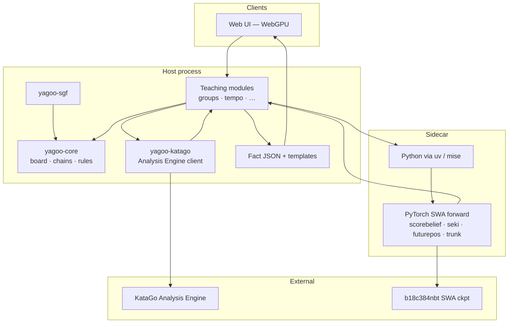
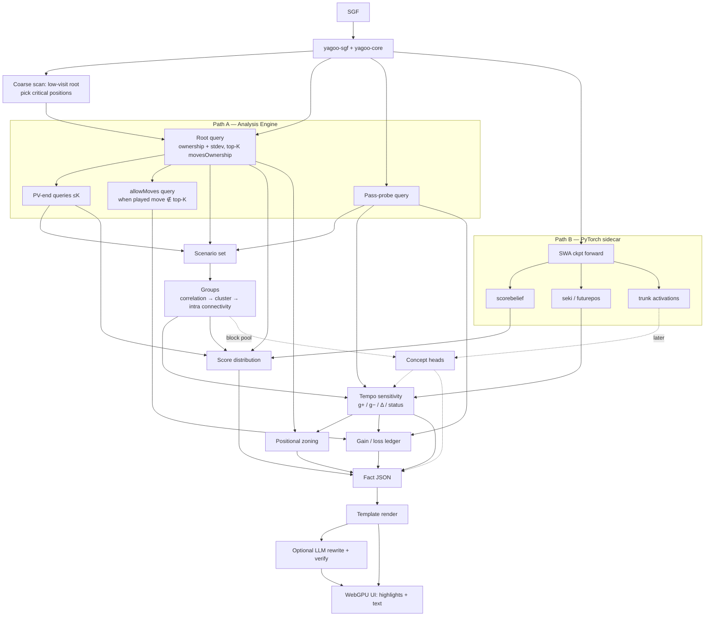

# Architecture & data flow

## Intended stack



| Concern | Choice |
| --- | --- |
| Core language | **Rust** (Cargo workspace) |
| Tooling / tasks | **mise** (mirrors [heron](https://github.com/minori-live/heron)) |
| Frontend | **Web + WebGPU** — not Electron |
| Node | Workspace scripts, docs site (VitePress), future web app |
| Python | **uv** under mise — model utilities, activation extract, concept-head training |
| CI | GitHub Actions, **latest major** action tags; Renovate updates them. **No** performance / timing tests in CI |

## Rust crate split

| Crate | Responsibility |
| --- | --- |
| `yagoo-core` | Coordinates (GTP / SGF), board, **chains** (串), liberties, captures, ko / positional superko, move legality, pass |
| `yagoo-sgf` | SGF → game record (main line, `AB`/`AW`, komi, rules, size, handicap) |
| `yagoo-katago` | Async JSON-lines client for `katago analysis`; typed queries/responses; fixture tests (no binary in CI) |

Teaching algorithms (groups, tempo, …) will land in dedicated crates or grow out of `yagoo-core` later — not implemented yet.

## Module data flow



## Repository layout

```text
.
├── README.md
├── docs/                     # Design docs + VitePress site (+ /demo)
├── packages/
│   └── ui/                   # @yagoo/ui — Vue goban + reviewer chrome
├── crates/
│   ├── yagoo-core/           # Board / rules
│   ├── yagoo-sgf/            # SGF parsing
│   └── yagoo-katago/         # Analysis Engine client
├── python/                   # uv-managed utilities (later)
├── scripts/                  # Local-dev helpers (model download, …)
├── mise.toml
├── Cargo.toml
├── pnpm-workspace.yaml
└── .github/workflows/ci.yml
```

## Frontend (`packages/ui` / `@yagoo/ui`)

Vue 3 component library, embeddable in the VitePress docs and intended to grow into the WebGPU web app (not Electron). UI chrome imitates [Sabaki](https://github.com/SabakiHQ/Sabaki); the goban reimplements [Shudan](https://github.com/SabakiHQ/Shudan)’s DOM / `shudan-*` classes / `--shudan-*` variables / map-style props (MIT; see `packages/ui/THIRD_PARTY_NOTICES.md`).

| Area | Notes |
| --- | --- |
| `Goban` | `signMap`, `markerMap`, `ghostStoneMap`, `heatMap`, `paintMap`, `lines`, coordinates, fuzzy placement + collision (`readjustShifts`), click events; optional `fuzzySeed` for deterministic shifts |
| `useGame` | `@sabaki/sgf` (parse only; `fs` / `iconv-lite` aliased empty) + `@sabaki/immutable-gametree` + `@sabaki/go-board` |
| `ReviewerLayout` | Tatami main + right sidebar (`WinrateGraph`, game-tree placeholder, `CommentBox`) + 40px `BottomBar` |
| Overlays | `BoardGeometry` + `OverlayRenderer` interface; `SvgOverlayRenderer` / `OverlayLayer` (group-outline demo). WebGPU renderer can swap in later without changing callers |
| Custom element | `<yagoo-board>` via `defineCustomElement` / `registerYagooBoard()` |

Docs consume the package through a ClientOnly / async demo page (`docs/demo/`). mise tasks: `ui:test`, `ui:check`, `ui:dev`, `ui:build`; wired into `mise run check` and CI (no performance/timing tests).
