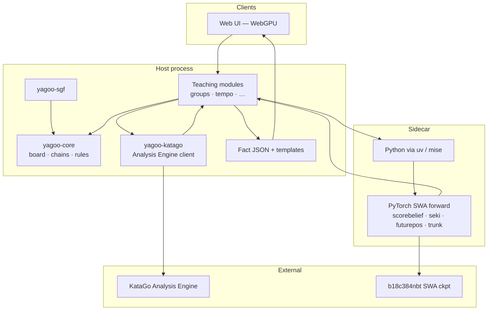
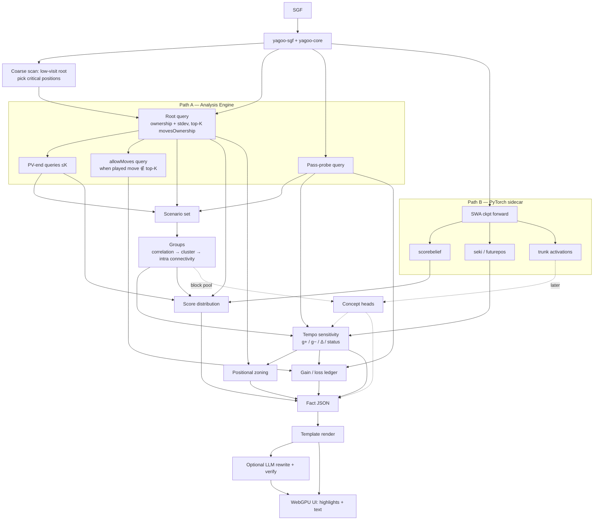

# Architecture & data flow

## Intended stack



| Concern | Choice |
| --- | --- |
| Core language | **Rust** (Cargo workspace) |
| Tooling / tasks | **mise** (mirrors [heron](https://github.com/minori-live/heron)) |
| Frontend | **Web + WebGPU** — not Electron |
| Node | Workspace scripts, docs site (VitePress), future web app |
| Python | **uv** under mise — model utilities, activation extract, concept-head training |
| CI | GitHub Actions, **latest major** action tags; Renovate updates them. **No** performance / timing tests in CI |

## Rust crate split

| Crate | Responsibility |
| --- | --- |
| `yagoo-core` | Coordinates (GTP / SGF), board, **chains** (串), liberties, captures, ko / positional superko, move legality, pass |
| `yagoo-sgf` | SGF → game record + **main-line replay** into `GameState` |
| `yagoo-katago` | Async JSON-lines client; **single-process id demux**; optional partials via `reportDuringSearchEvery`; fixture tests (no binary in CI) |
| `yagoo-snapshot` | Versioned `PositionSnapshot` / `GameSnapshot` + `PipelineEvent` NDJSON types (black-positive) |
| `yagoo-pipeline` | Async **stream** of analysis events (scan → swing-select → deep); drives KataGo; fills snapshots |
| `yagoo-cli` | `yagoo analyze` binary — NDJSON stream + optional aggregate JSON |

Teaching algorithms (groups, tempo, …) consume **snapshots only** — not implemented yet.

## Module data flow



## Repository layout

```text
.
├── README.md
├── docs/                     # Design docs + VitePress site
├── crates/
│   ├── yagoo-core/           # Board / rules
│   ├── yagoo-sgf/            # SGF parse + replay
│   ├── yagoo-katago/         # Analysis Engine client
│   ├── yagoo-snapshot/       # Snapshot schema + events
│   ├── yagoo-pipeline/       # Streaming analyze pipeline
│   └── yagoo-cli/            # `yagoo` binary
├── python/                   # uv-managed utilities (later)
├── scripts/                  # Local-dev helpers (model download, …)
├── mise.toml
├── Cargo.toml
└── .github/workflows/ci.yml
```
