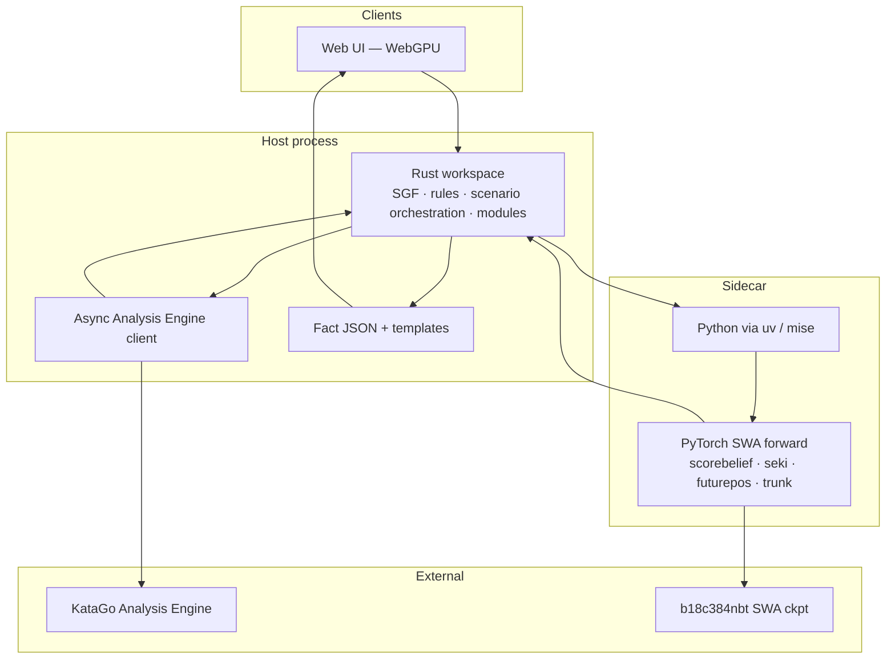
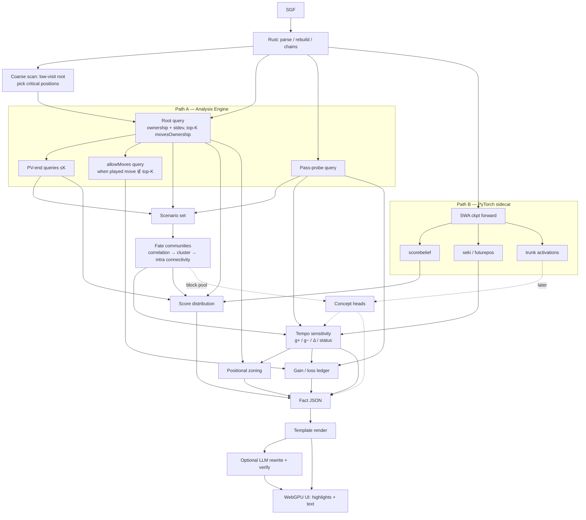

# Architecture & data flow

## Intended stack



| Concern | Choice |
| --- | --- |
| Core language | **Rust** (Cargo workspace) |
| Tooling / tasks | **mise** (mirrors [heron](https://github.com/minori-live/heron)) |
| Frontend | **Web + WebGPU** — not Electron |
| Node | Workspace scripts, docs site (VitePress), future web app |
| Python | **uv** under mise — model utilities, activation extract, concept-head training |
| CI | GitHub Actions, **latest major** action tags; Renovate updates them. **No** performance / timing tests in CI |

## Module data flow



## Repository layout (scaffold)

```text
.
├── README.md                 # Landing overview
├── docs/                     # Design docs + VitePress site
├── crates/                   # Rust workspace members
│   └── yagoo-core/           # Stub crate (algorithms later)
├── python/                   # uv-managed utilities (later)
├── mise.toml                 # Tool versions + tasks
├── Cargo.toml                # Workspace root
├── package.json              # Node workspace root
└── .github/workflows/ci.yml  # Docs + lint + cargo check
```

Algorithms are **not** implemented in the first documentation PR; crates and Python dirs exist so tooling and CI have a real shape.
